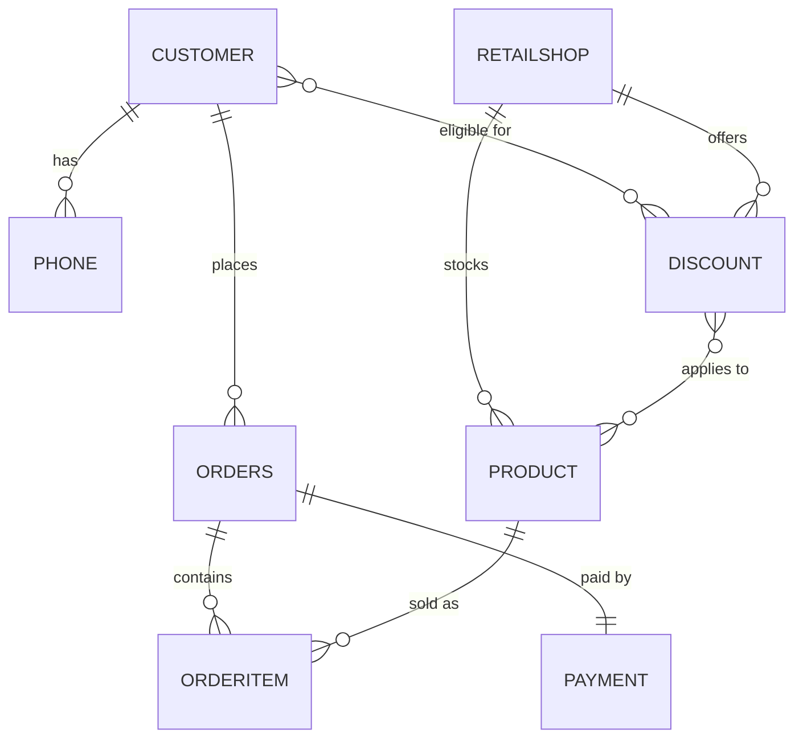

# 🛒 Retail Store Management System

A full-stack retail commerce platform with customer shopping, cart & checkout, online/COD
payments, a discount engine, and an **admin Business-Intelligence dashboard** for shop
performance — all backed by a real MySQL database.

<p>
  
  
  
  
  
  
</p>

---

## 📑 Table of Contents

- [Overview](#-overview)
- [Features](#-features)
- [Tech Stack](#-tech-stack)
- [Architecture](#-architecture)
- [Data Model](#-data-model)
- [Getting Started](#-getting-started)
- [Configuration](#-configuration)
- [API Reference](#-api-reference)
- [Admin Analytics & Business Intelligence](#-admin-analytics--business-intelligence)
- [Order & Discount Logic](#-order--discount-logic)
- [Project Structure](#-project-structure)
- [Security Notes](#-security-notes)
- [Known Limitations](#-known-limitations)

---

## 🔎 Overview

The system is split into two applications:

| App | Directory | Runs on | Description |
|-----|-----------|---------|-------------|
| **Backend** | `retail_store_backend/` | `http://localhost:8080` | Spring Boot REST API + JWT security + JPA/MySQL persistence |
| **Frontend** | `retail_stores_frontend/` | `http://localhost:5173` | React + Vite single-page app (Tailwind CSS) |

Customers can browse shops near their city, add products to a cart, apply discounts, and pay
online (Razorpay) or via cash on delivery. Admins get a dedicated analytics dashboard that
computes shop revenue, inventory health, and performance rankings **entirely from live
database data**.

---

## ✨ Features

### Customer

- 🔐 **Register / login** with JWT authentication (BCrypt-hashed passwords)
- 👤 **Editable profile** (name, street, city, pincode)
- 📍 **Nearby shops** — shops are surfaced based on the customer's city
- 🛍️ **Product catalog** per shop
- 🛒 **Cart** — add / decrement / remove items, live cart drawer in the navbar
- 🎟️ **Discount engine** — bulk, festival, and high-value discounts computed server-side
- 💳 **Checkout** — Razorpay online payment or Cash on Delivery
- 📦 **Order history**

### Admin

- 📊 **Business-Intelligence dashboard** focused on **shop performance**
- 💰 Executive KPIs: revenue, orders, AOV, inventory value, stock units, products sold
- 🏆 Top shops by revenue, revenue-contribution donut, revenue-vs-inventory scatter
- 📉 Inventory health: low-stock & out-of-stock reporting (configurable threshold)
- 🔍 Per-shop drill-down (top products, inventory breakdown, performance score & tier)
- 📅 Date-range filtering across all analytics
- 🧠 Legacy insights: high-value customers, above-average products/customers, most-ordered product, high-value shops

> All analytics endpoints are **ADMIN-protected on the backend** (not just hidden in the UI).

---

## 🧰 Tech Stack

### Backend (`retail_store_backend`)

- **Java 17**, **Spring Boot 3.5.7**
- Spring Web, Spring Data JPA (Hibernate 6), Spring Security
- **MySQL 8** (`mysql-connector-j`)
- **JJWT 0.11.5** — JWT creation & validation (HS512)
- **Lombok** — boilerplate-free entities/DTOs
- **Razorpay Java SDK 1.4.3** — online payments
- **springdoc-openapi 2.5.0** — Swagger UI
- Maven (wrapper included: `./mvnw`)

### Frontend (`retail_stores_frontend`)

- **React 19**, **Vite 7**
- **Tailwind CSS 3**, PostCSS, Autoprefixer
- **react-router-dom 7**, **axios 1.13**, **prop-types**
- Dependency-free SVG/CSS charts (no charting library)

---

## 🏗️ Architecture

```
┌──────────────────────────┐        HTTP + JWT (Bearer)        ┌──────────────────────────┐
│   React SPA (Vite)       │  ───────────────────────────────▶ │   Spring Boot REST API    │
│   localhost:5173         │                                   │   localhost:8080          │
│   • axios (api.js)       │ ◀───────────────────────────────  │   • JWT filter + RBAC     │
│   • AuthContext + token  │            JSON responses         │   • Domain services       │
└──────────────────────────┘                                   └────────────┬─────────────┘
                                                                             │ JPA / Hibernate
                                                                             ▼
                                                                ┌──────────────────────────┐
                                                                │   MySQL 8                 │
                                                                │   retail_store_management │
                                                                └──────────────────────────┘
```

The backend follows a **domain-package layout** (`com.retailstore.<domain>` with
`controller / service / repository / entity / dto` in each). Admin analytics live in an
isolated `com.retailstore.admin.analytics` package.

The frontend attaches the JWT from `localStorage` to every request via an axios interceptor
(`src/services/api.js`), so no proxy is required — it calls `http://localhost:8080` directly.

---

## 🗃️ Data Model



**Tables:** `customer`, `phone`, `retailshop`, `product`, `orders`, `orderitem`, `payment`,
`discount`, and the join tables `customer_discount` and `discount_product`.

Key modeling facts (important for the analytics layer):

- **`orders` has no `shop_id`.** A shop is attributed to a sale through
  `OrderItem → Product → RetailShop`.
- **Line/shop revenue = `Σ (orderitem.price × orderitem.quantity)`** — never `orders.total_amount`
  (which is per-order and post-discount, and can't be split by shop).
- A **real sale** is an order whose `status NOT IN ('Cart', 'High_Value', 'Abandoned')`
  (those three are active/cleared carts, not completed sales).

---

## 🚀 Getting Started

### Prerequisites

- **Java 17** (JDK)
- **MySQL 8** — or **Docker** (a `docker-compose.yml` is provided)
- **Node.js 20.19+** (required by Vite 7)

### 1. Clone

```bash
git clone <your-repo-url>
cd retail_store_project
```

### 2. Start the database

**Option A — Docker (recommended):** starts MySQL 8 on host port **3307** and auto-loads
`init.sql` (schema + sample shops/customers/products) on first run.

```bash
cd retail_store_backend
docker compose up -d
```

**Option B — local MySQL:** create the schema and load the seed manually.

```bash
mysql -u root -p < retail_store_backend/init.sql
```

> ⚠️ The discount endpoint calls a MySQL stored procedure `apply_bulk_discount(order_id)`
> (invoked by `OrderRepository`). This procedure is **not** included in `init.sql` — it must
> exist in the database for `/api/discounts/apply` to work.

### 3. Configure & run the backend

Edit `retail_store_backend/src/main/resources/application.properties` to match your database
(see [Configuration](#-configuration)), then:

```bash
cd retail_store_backend
./mvnw spring-boot:run
```

The API starts on **http://localhost:8080**. Swagger UI: **http://localhost:8080/swagger-ui.html**

### 4. Run the frontend

```bash
cd retail_stores_frontend
npm install
npm run dev
```

The SPA starts on **http://localhost:5173** and talks to the backend at `http://localhost:8080`.

---

## ⚙️ Configuration

`retail_store_backend/src/main/resources/application.properties` (values shown are
**placeholders** — do not commit real secrets):

```properties
spring.application.name=Retail Store Backend

# Datasource — Docker maps MySQL to host port 3307; use 3306 for a local install
spring.datasource.url=jdbc:mysql://localhost:3307/retail_store_management_system
spring.datasource.username=<db-username>
spring.datasource.password=<db-password>
spring.datasource.driver-class-name=com.mysql.cj.jdbc.Driver

spring.jpa.hibernate.ddl-auto=update
spring.jpa.show-sql=true
spring.jpa.properties.hibernate.dialect=org.hibernate.dialect.MySQL8Dialect

# JWT (HS512) — 24h expiry
app.jwt-secret=<long-random-secret>
app.jwt-expiration-ms=86400000

# Razorpay (test keys)
razorpay.key.id=<razorpay-key-id>
razorpay.key.secret=<razorpay-key-secret>
```

**Ports at a glance:**

| Service | Port | Notes |
|---------|------|-------|
| Backend API | `8080` | Spring Boot default |
| Frontend (Vite dev) | `5173` | `strictPort: true` |
| MySQL (Docker) | `3307` → `3306` | host → container |
| MySQL (local) | `3306` | default; update the datasource URL |

---

## 🌐 API Reference

Base URL: `http://localhost:8080`. Protected routes require an `Authorization: Bearer <token>`
header. Roles: `ROLE_USER`, `ROLE_ADMIN`.

### Auth — `/api/auth` (public)

| Method | Endpoint | Description |
|--------|----------|-------------|
| `POST` | `/register` | Register a customer; creates a `ROLE_USER` with a BCrypt password |
| `POST` | `/login` | Authenticate; returns a JWT + customer info (`LoginResponseDTO`) |
| `GET`  | `/me` | Current logged-in customer resolved from the token |

### Customers — `/api/customers` (authenticated)

| Method | Endpoint | Description |
|--------|----------|-------------|
| `GET` | `/profile` | Get the logged-in customer's profile |
| `PUT` | `/profile` | Update name / street / city / pincode |

### Shops — `/api/shops`

| Method | Endpoint | Description |
|--------|----------|-------------|
| `GET` | `/nearby` | Shops in the authenticated customer's city, with products & inventory value |

### Products — `/api/products`

| Method | Endpoint | Description |
|--------|----------|-------------|
| `GET`  | `/` | All products |
| `POST` | `/` | Add a product (requires `shopId`) |
| `GET`  | `/shop/{shopId}` | Products for a shop |

### Orders — `/api/orders` (authenticated)

| Method | Endpoint | Description |
|--------|----------|-------------|
| `GET`    | `/` | Order history (excludes cart statuses) |
| `GET`    | `/cart` | Current cart |
| `POST`   | `/cart` | Add an item (`{ productId, quantity }`) |
| `DELETE` | `/cart/item/{productId}` | Decrement / remove a cart line |
| `POST`   | `/checkout` | Checkout (`{ paymentMode, deliveryMode }`) → decrements stock, marks `Completed` |
| `DELETE` | `/cart` | Clear the cart (marks it `Abandoned`) |

### Discounts — `/api/discounts` (authenticated)

| Method | Endpoint | Description |
|--------|----------|-------------|
| `POST` | `/apply` | Compute the best discount (bulk / festival / high-value) for the active cart |

### Payments — `/api/payments` (authenticated)

| Method | Endpoint | Description |
|--------|----------|-------------|
| `POST` | `/create-order` | Create a Razorpay order (amount in paise, INR) |
| `POST` | `/verify` | Verify the Razorpay payment signature |
| `GET`  | `/order/{orderId}` | Payment for an order (ownership-checked) |
| `PUT`  | `/{paymentId}/status?status=` | Update payment status (ownership-checked) |

### Admin — legacy insights — `/api/admin` (ADMIN)

| Method | Endpoint | Description |
|--------|----------|-------------|
| `GET` | `/customers/high-value?amount=` | Customers whose total spend exceeds `amount` |
| `GET` | `/products/above-average` | Products priced above the average price |
| `GET` | `/analytics/above-average-customers` | Customers spending above the average customer |
| `GET` | `/most-ordered-product` | Most-ordered product by units |
| `GET` | `/shops/high-value?minValue=` | Shops whose sales value exceeds `minValue` |

### Admin — BI analytics — `/api/admin/analytics` (ADMIN)

| Method | Endpoint | Description |
|--------|----------|-------------|
| `GET` | `/summary?from&to&lowStockThreshold` | Executive KPI summary |
| `GET` | `/shops?from&to` | Per-shop performance (revenue, orders, AOV, inventory, score, tier) |
| `GET` | `/shops/{shopId}?from&to&lowStockThreshold` | Shop drill-down (+ top products, inventory) |
| `GET` | `/top-products?limit&from&to` | Top-selling products by units |
| `GET` | `/inventory/low-stock?threshold` | Products at/below the low-stock threshold |
| `GET` | `/inventory/out-of-stock` | Products with zero (or negative) stock |

---

## 📊 Admin Analytics & Business Intelligence

All metrics are aggregated in the backend from real data (no static/dummy numbers). Metric
definitions:

| Metric | Formula |
|--------|---------|
| **Shop revenue** | `Σ (orderitem.price × quantity)` over sale-status items of that shop |
| **Products sold** | `Σ orderitem.quantity` |
| **Shop orders** | `COUNT(DISTINCT order_id)` |
| **Inventory value** | `Σ (product.price × stock_quantity)` |
| **Stock units** | `Σ stock_quantity` |
| **Average Order Value (AOV)** | `revenue / orders` (0 when orders = 0) |
| **Revenue contribution %** | `shopRevenue / totalRevenue × 100` |
| **Revenue-to-Inventory ratio** | `revenue / inventoryValue` (0 when inventory = 0) |
| **Performance score** | `100 × (0.5·rev/maxRev + 0.3·orders/maxOrders + 0.2·sold/maxSold)` |
| **Performance tier** | `≥ 66` High · `33–65` Medium · `< 33` Low |
| **Low stock** | `0 < stock ≤ threshold` (default 10, configurable) |
| **Out of stock** | `stock ≤ 0` |

> "Total orders" counts distinct sale-status orders that contain at least one line item.
> Because one multi-shop order is counted once per shop, per-shop order counts can sum higher
> than the global total — this is expected and correct.

---

## 🔄 Order & Discount Logic

**Order status lifecycle** (managed by `OrderService`):

```
add to cart ──▶ Cart ──(cart total ≥ ₹2000)──▶ High_Value
   │                                               │
   ├────────────── checkout ───────────────────────┤──▶ Completed  (stock decremented)
   │
   └────────────── clear cart ─────────────────────────▶ Abandoned
```

**Discount engine** (`DiscountService.applyDiscount`) — evaluated on the active cart:

1. **Bulk discount** via the `apply_bulk_discount` stored procedure.
2. **Festival discount** — the best currently-valid discount per shop (highest percentage).
3. **High-value discount** — 10% when the post-bulk amount exceeds ₹2500.
4. The **best single offer** is applied; the cart is marked `High_Value` if the final amount exceeds ₹2000.

---

## 🗂️ Project Structure

```
retail_store_project/
├── retail_store_backend/                 # Spring Boot API
│   ├── src/main/java/com/retailstore/
│   │   ├── RetailStoreBackendApplication.java
│   │   ├── admin/                         # legacy admin insights
│   │   │   ├── controller/ · repository/ · service/
│   │   │   └── analytics/                 # BI dashboard (isolated)
│   │   │       ├── controller/ · service/ · repository/ · dto/
│   │   ├── customer/                      # controller · dto · entity · repository · service
│   │   ├── shop/
│   │   ├── product/
│   │   ├── order/
│   │   ├── payment/
│   │   ├── discount/
│   │   └── security/                      # SecurityConfig · JWT provider/filter · auth
│   ├── src/main/resources/application.properties
│   ├── init.sql                           # schema + sample seed data
│   ├── docker-compose.yml                 # MySQL 8 (host port 3307)
│   └── pom.xml
│
└── retail_stores_frontend/                # React + Vite SPA
    ├── index.html
    ├── vite.config.js
    └── src/
        ├── App.jsx
        ├── components/                     # Navbar, Modal, ProductCard, ShopCard, …
        │   └── admin/                      # KpiCard, Panel, ShopPerformanceTable, ShopDetailModal
        │       └── charts/                 # BarChartH, DonutChart, ScatterPlot
        ├── context/AuthContext.jsx
        ├── pages/                          # Home, Login, Register, UserDashboard,
        │                                   #   AdminDashboard, Checkout, Payment, Profile, Orders
        ├── routes/ProtectedRoute.jsx
        ├── services/                       # api.js (axios), analytics.js
        └── utils/format.js                 # ₹ / number / percent helpers
```

---

## 🔐 Security Notes

- **JWT (HS512):** the subject is the user's email; authorities are loaded from the DB `role`
  column on every request. Tokens expire after 24h.
- **Route protection:** `SecurityConfig` guards `/api/admin/**` for `ADMIN`/`ROLE_ADMIN` (which
  covers `/api/admin/analytics/**`), and `/api/customers/**` & `/api/orders/**` for authenticated
  users. `/api/auth/**`, `/api/shops/**`, and `/api/products/**` are open.
- **Passwords** are stored as BCrypt hashes.
- ⚠️ **Do not commit real secrets.** `application.properties` and `docker-compose.yml` ship with
  placeholders here — keep DB passwords, the JWT secret, and Razorpay keys out of version control
  (use environment variables or an untracked local file), and rotate any credential that has
  already been committed.

A seeded admin account (`admin@gmail.com`, `ROLE_ADMIN`) is defined in `init.sql`; set a password
you control before using it.

---

## ⚠️ Known Limitations

- The default datasource URL points at Docker MySQL on port **3307**; a local MySQL install
  usually listens on **3306** — update `spring.datasource.url` accordingly.
- The `apply_bulk_discount` stored procedure is required by the discount flow but is **not**
  part of `init.sql` (see [Getting Started](#-getting-started)).
- `init.sql` seeds a **minimal** sample dataset (8 shops, a few products/customers) — enough to
  explore the app, not a full production dataset.
- With the seed data, no products are low/out-of-stock at the default threshold; the low-stock
  threshold is configurable so the inventory panels can be demonstrated.

---

## 📜 License

No license file is currently included. Add one (e.g. MIT) if you intend to open-source this project.
